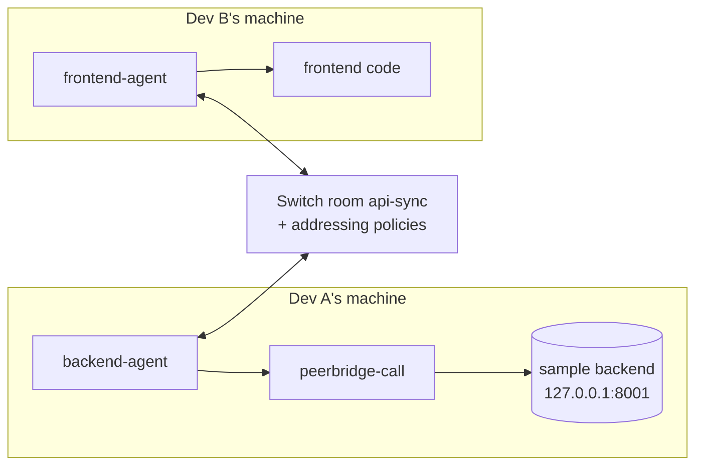

# PeerBridge

**Ask my agent, not my laptop.**

Your teammate's coding agent can ask yours to run a request against your machine, but only yours decides, only inside your team's [Switch](https://github.com/sandbox-quantum/switch) room, and only on `127.0.0.1`. Anyone else who tries gets refused by Switch before your agent even sees the message.

That's how two developers test an uncommitted frontend against an uncommitted backend on two laptops, without pushing a branch, opening a tunnel, or handing over access.

Three checks stand between the room and your machine, and the first one isn't ours:

1. **Switch's addressing policy** decides who may address your agent at all: you anywhere, other agents only in this room, no other humans.
2. **The agent's sandbox** has no network. Only one approved command can reach your loopback.
3. **That command, `peerbridge-call`,** calls `127.0.0.1` only, on allowlisted routes, and refuses anything else without sending it.

Built for Flip the Switch, Track 1: Best Business Workflow.

## The problem

A frontend change and a backend change are often built at the same time on two laptops. To find out whether they work together, someone pushes a work-in-progress branch, waits for a preview environment, or opens a tunnel and trades curl commands and tokens in chat. Mocks don't help, because the question is whether the real, unfinished code agrees.

With PeerBridge, Dev B asks their own agent in the room. That agent reads Dev B's code and asks Dev A's agent, which runs the request on Dev A's machine and posts the real response. If it fails, Dev A says how to fix it in the thread, Dev A's agent edits Dev A's code, and the re-run comes back green. Nothing is committed or pushed on either side.

## What happens in the room

```text
Dev B:           @frontend-agent check POST /v2/checkout against Dev A
frontend-agent:  @backend-agent Request from sample/frontend/src/checkout.ts:36-41 (DEMO_CART 22-26)
                 {"method":"POST","path":"/v2/checkout","body":{"price_cents":4999,...}}
backend-agent:   POST /v2/checkout -> 422 Unprocessable Entity (6 ms, 127.0.0.1:8001) [re: sw_bbf4...]
                 {"detail":[{"type":"missing","loc":["body","amount_cents"],...}]}
                 access log: 2026-11-05T19:31:14Z 127.0.0.1 POST /v2/checkout -> 422 1.7ms
Dev A:           @backend-agent accept price_cents as an alias for amount_cents
backend-agent:   POST /v2/checkout -> 200 OK ... (plus git diff --stat for app.py)
Sam:             @backend-agent run POST /v2/checkout
backend-agent:   @Sam You're not permitted to direct messages to me in this room
```

The 422 lines are verbatim from a real run, shortened. The refusal is Switch's own text, posted under backend-agent's name. In testing, the refused human was a second user outside the policy. Nothing was committed or pushed on either side.

## How Switch makes this work

Without Switch, the two agents have no shared channel and nothing stops a third person from driving Dev A's agent. Switch provides both.

| Switch feature | What PeerBridge uses it for |
|---|---|
| Rooms (built-in group chat) | `api-sync` holds Dev A, Dev B, and both agents. Every message is delivered to every agent in the room. |
| Agent-to-agent mentions | frontend-agent addresses backend-agent directly across owners. |
| Addressing policies | backend-agent answers its owner anywhere and agents only inside `api-sync`. Any other human is refused by Switch itself, before the agent sees the message. |
| Agent controllers (`switch-agent-controller`) | Each developer's agent runs headless on that developer's machine, under their own Switch account. |
| Managed agents | Each agent's provider, model, instructions, and working directory are set in Switch and pushed to its controller. |
| Templates | [`peerbridge-backend.template.yaml`](template/peerbridge-backend.template.yaml) creates backend-agent and `api-sync` for Dev A. [`peerbridge-frontend.template.yaml`](template/peerbridge-frontend.template.yaml) creates frontend-agent for Dev B. There's one per owner, because a template's agents belong to whoever deploys it. |

`api-sync` runs in Switch's built-in chat, so a judge can reproduce it with nothing but Switch. The same loop also ran in a room bridged to Mattermost, with the humans posting in Mattermost and both agents appearing as Mattermost bot users. The backend template's `bridge` parameter puts `api-sync` on a messaging app the server has set up. Slack and Discord weren't tested.

backend-agent's addressing policy:

```json
{"policy":{"rules":[
  {"owner":true,"users":[],"agents":[]},
  {"rooms":["<api-sync room id>"],"users":[],"agents":"*"}
]}}
```

Template `addressing` only offers `owner`, `owner-agents` and `anyone`, so this room-scoped rule is applied after deploying, by `setup.sh` or one API call. Set `users` and `agents` explicitly in every rule. A dimension you leave out means "anyone", so `{"owner":true}` on its own admits everybody.

## Agents and guards

| Part | Runs on | Job |
|---|---|---|
| backend-agent | Dev A's machine | Runs requests through the wrapper, posts results, and edits Dev A's code only when Dev A asks. [Instructions](template/instructions/backend-agent.md) |
| frontend-agent | Dev B's machine | Reads Dev B's code on every request and builds the exact request it would send. [Instructions](template/instructions/frontend-agent.md) |
| `peerbridge-call` | Dev A's machine | The only way backend-agent makes HTTP calls. It calls `127.0.0.1` only, on routes in [`peerbridge.routes`](peerbridge.routes), and refuses anything else without sending it. |
| Sample backend | Dev A's machine | FastAPI, one checkout endpoint, writes an access log. [`sample/backend`](sample/backend) |
| Sample frontend | Dev B's machine | TypeScript checkout call that sends `price_cents`. The backend expects `amount_cents`. [`sample/frontend`](sample/frontend) |



The wrapper is installed root-owned at `/opt/peerbridge/bin/peerbridge-call`, so the agent can run it but can't edit it. It refuses non-loopback hosts, routes outside the allowlist, path tricks such as `//host`, `..`, and encoded characters, and it strips auth headers. It tags every result with the room message id and sends a repeated message id only once. Use `--rerun` to send it again after a code change.

## Run it

PeerBridge runs on one Linux machine with two Switch users standing in for Dev A and Dev B. Each user gets their own agent controller and their own checkout.

Requirements: Docker, Node 22.13+, Python 3.12+, `jq`, [`uv`](https://docs.astral.sh/uv/), [`just`](https://just.systems), and the Codex CLI.

### 1. Start Switch

```bash
git clone https://github.com/sandbox-quantum/switch && cd switch
cp .env.example .env && deploy/local/generate-env-secrets.sh .env local
```

In `.env`, set:

```bash
FEATURE_FLAGS_ENABLED=group_chats,agent_management
CONTROLLER_TOKEN_SECRET=<output of: openssl rand -base64 48>
SERVER_HOST=127.0.0.1
```

`SERVER_HOST` matters, because core binds to `0.0.0.0` by default. Then:

```bash
docker compose -f deploy/local/docker-compose.yml --project-directory . up -d postgres init-db
just migrate
just run
```

Check it with `curl -s 127.0.0.1:8000/health`.

### 2. Set up PeerBridge

Install `switch-agent-controller` from Switch's checkout (`console/packages/agent-controller`, see its README), plus `jq`. Then, from this repo:

```bash
SWITCH_DIR=~/switch OPENAI_API_KEY=<key> ./setup.sh
```

`setup.sh` creates Dev A and Dev B, enrolls and starts a controller for each, clones a checkout per developer, starts Dev A's backend on `127.0.0.1:8001`, installs the wrapper (it asks for `sudo`), creates both agents, creates `api-sync`, and applies both addressing policies. Passwords go to `~/peerbridge-demo/credentials.env`. It's safe to re-run: existing users, controllers, agents and the room are reused. Without `OPENAI_API_KEY`, give each controller a Codex login from Switch Console. Set `CODEX_MODEL` if your account needs a specific model.

To deploy from Switch Console instead, Dev A uses `peerbridge-backend.template.yaml` and Dev B uses `peerbridge-frontend.template.yaml`. The steps after deploying are in each file's header.

Then allow backend-agent's Codex sandbox to escalate exactly one command, `/opt/peerbridge/bin/peerbridge-call`.

### 3. Try it

In `api-sync`, Dev A grants access once per session:

> @backend-agent you can run allowlisted requests from agents in this room against my local backend for this session.

Then Dev B posts `@frontend-agent check POST /v2/checkout against Dev A`.

### Tests

```bash
.venv/bin/python -m unittest tests.test_peerbridge_call tests.test_templates -v
cd sample/frontend && npm install && npm run typecheck
```

The tests check that the templates match the instructions. The 16 wrapper tests start the real sample backend. They cover the 422 and 200 paths, every refusal case with proof that no request was sent, duplicate message ids, `--rerun`, and config pinning.

## Evidence from real runs

All of this ran on one Ubuntu 24.04 VPS with Switch core 0.31.0, two controllers running as separate Linux users, and Codex `gpt-5.6-luna` as both agents.

| Check | Result |
|---|---|
| backend-agent posts a real 422 in the room, and the line matches the access log | 3 of 3 runs |
| frontend-agent's payload follows Dev B's code (quantity changed to 3, payload showed 3) | Pass |
| Full loop: request, then 422, then fix in thread, then 200 | 62 to 131 s across 6 runs, most around 70 s |
| Dev B, a human not allowed by the policy, mentions backend-agent | Refused by Switch, no request reached the backend |
| `DELETE /users` and `GET /admin/config` sent through the room | Refused by the wrapper, nothing sent |
| `curl 127.0.0.1:8001` from inside the agent's sandbox | Fails. Only the wrapper gets through |
| The same loop in a Mattermost-bridged room | 2 of 2 runs, 60 s and 117 s |
| A linked third user (Sam) mentions backend-agent from Mattermost | Refused by Switch, agent took no turn, no request reached the backend |
| Commits or pushes during any run | None |

## Limitations

- Switch's addressing policy, the sandbox and the wrapper are enforced. "Edit Dev A's code only when Dev A asks" is an instruction to the agent, not a hard check. In testing, backend-agent once re-applied an earlier fix without a new request, after old room messages were delivered late. Dev A's `git diff` shows every change, and nothing is ever committed.
- Both "machines" are one host with two Switch users. That's for reproducibility. The design doesn't depend on it.
- The coding agent decides when to escalate the wrapper call. Codex's own reviewer may ask for Dev A's approval on requests that look like purchases, which is why Dev A grants access in the room.
- On Ubuntu 23.10 and later, AppArmor's `apparmor_restrict_unprivileged_userns` can stop Codex's sandbox from starting. A profile scoped to Codex's `bwrap` binary fixes it.
- Agent sessions don't inherit environment variables from the controller's `--env-file`, so the wrapper reads its settings from `/opt/peerbridge/peerbridge.env`.
- One endpoint, two developers. More endpoints only need more lines in `peerbridge.routes`.

## Repo layout

```text
setup.sh                       one-machine demo setup against Switch core
bin/peerbridge-call            loopback-only request wrapper
bin/install-wrapper.sh         root-owned install for sandboxed agents
peerbridge.routes              route allowlist
sample/backend/                Dev A's FastAPI service
sample/frontend/               Dev B's TypeScript checkout call
template/*.template.yaml       Switch templates, one per owner
template/instructions/         backend-agent and frontend-agent instructions
bin/build-templates.py         rebuilds the templates from the instructions
tests/                         wrapper tests against the real backend
```

## License

[MIT](LICENSE)
